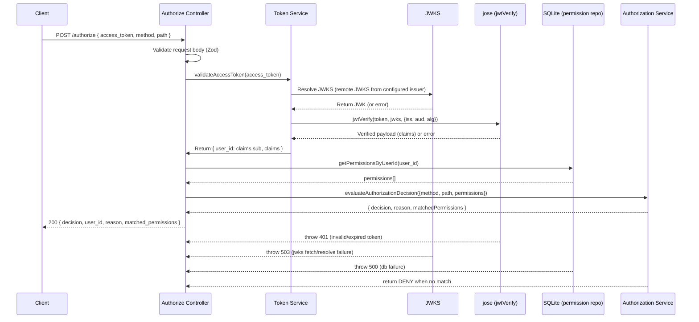

# Authentication & Authorization Sequence Diagram

This document describes the complete runtime flow for POST /authorize in the current codebase and includes a sequence diagram (Mermaid) plus concise explanations of each step and failure modes.

**Step-by-step explanation**

- Entry and validation
  - The client calls `POST /authorize` with a JSON body containing `access_token`, `method`, and `path`.
  - The controller at [src/controllers/authorize.controller.ts](src/controllers/authorize.controller.ts) validates the request body with Zod. Schema failures return HTTP 400 with a structured error payload.

- Authentication (token verification)
  - The controller calls `validateAccessToken` in [src/services/token.service.ts](src/services/token.service.ts).
  - `validateAccessToken` rejects empty or malformed token strings immediately with a 401 AppError.
  - JWKS resolution:
    - The service uses a remote JWKS resolver created by `createRemoteJWKSet(new URL('/.well-known/jwks.json', issuer))` and caches it.
    - `jwtVerify` (from `jose`) is called with:
    - `algorithms: ['RS256']`
      - `issuer` and `audience` from configuration (Auth0 issuer and audience).
  - On successful verification `validateAccessToken` enforces that `sub` exists and that `iss` matches the configured issuer. It returns `{ user_id: claims.sub, claims }`.

- Error handling during authentication
  - Token expired, signature invalid, wrong audience/issuer, or malformed → AppError 401 `Authentication failed`.
  - JWKS fetch/resolution failures or remote dependency errors (timeouts/no-matching-key) → AppError 503 `Authentication service temporarily unavailable`.
  - Unexpected internal errors are mapped to 503 to avoid leaking internals.

- Permission lookup
  - The controller calls `getPermissionsByUserId(user_id)` in [src/services/permission.repository.ts](src/services/permission.repository.ts).
  - That function initializes/opens the SQLite DB (via [src/db/sqlite.ts](src/db/sqlite.ts)), runs a parameterized `SELECT` to fetch `user_permissions` rows, and returns them as `PermissionRecord[]`. DB read failures produce a 500 AppError.

- Authorization decision
  - Controller invokes `evaluateAuthorizationDecision` in [src/services/authorization.service.ts](src/services/authorization.service.ts) with `{ method, path, permissions }`.
  - Mapping and matching rules:
    - HTTP method → action mapping: GET→read, POST/PUT/PATCH→write, DELETE→delete.
    - Resource matching is segment-based: normalize by trimming slashes and splitting on `/`.
    - `*` matches exactly one segment (a resource equal to single `*` matches any depth).
    - Collection resources may match one deeper child segment (assignment-specific inheritance rule).
  - Candidate ranking (specificity):
    1. More literal (non-`*`) segments wins.
    2. If tied, more total segments wins.
    3. If still tied, `deny` wins over `allow`.
  - If no candidate matches → return DENY with reason `No matching permission` and empty `matchedPermissions`.
  - If a candidate wins → return ALLOW or DENY based on the winning rule effect, and `matchedPermissions` contains the winning permission record(s).

- Response shaping and invariants
  - Successful response (HTTP 200) includes:
    - `decision`: `ALLOW` or `DENY`
    - `user_id`: the verified JWT `sub` (controller never accepts identity from the request body)
    - `reason`: short human-readable rationale
    - `matched_permissions`: array of `{ action, resource, effect }` for matched rule(s)
  - The access token is never echoed in the response.
  - Unsupported HTTP methods are rejected by Zod and yield HTTP 400.

**Failure summary mapping**

- 400: Bad request body (Zod validation error)
- 401: Authentication failed (invalid/expired token, wrong issuer/audience, missing `sub`)
- 403: (not used by current flow; decisions use `DENY` in 200 responses)
- 500: Internal server errors (DB initialization failures, unexpected exceptions)
- 503: JWKS fetch/verification dependency failures or other auth-service unavailability

**Where the code lives**

- Controller and request validation: [src/controllers/authorize.controller.ts](src/controllers/authorize.controller.ts)
- Token verification / JWKS handling: [src/services/token.service.ts](src/services/token.service.ts)
- Permission repository (SQLite): [src/services/permission.repository.ts](src/services/permission.repository.ts)
- Authorization rules & matching: [src/services/authorization.service.ts](src/services/authorization.service.ts)
- DB init: [src/db/sqlite.ts](src/db/sqlite.ts)
- High-level documentation: [README.md](../README.md)

---

If you'd like, I can also:
- produce a PNG/SVG export of the Mermaid diagram and add it to `docs/`,
- generate an ASCII-style sequence diagram for plain-text usage,
- or add a compact troubleshooting checklist for the common 401/503 cases.

Which of those (if any) do you want next?